# Design Justification

This document justifies three interaction decisions of the kit checkout kiosk and compares the original Figma design with the Unity implementation.

**Unity version:** 6000.5.7f1
**Build / commit:** FILL IN
**Related documents:** [testing report](testing.md), [AI use](ai-use.md)

The Unity kiosk was built from the team's own Figma design. Most of the design was kept, with some changes caused by interactions and by how easy each section was to implement. Parts that still need real data are marked **FILL IN**.

---

## 1. Interaction decisions

### Decision 1: A kit that is not available can still be reserved for after the current reservation

| | |
|---|---|
| **User problem** | When the user presses a kit that is not available, they would be left with no options. They also need to know when the kit is free again. |
| **HCI principle** | FILL IN |
| **How the design addresses it** | Pressing a kit that is not available opens the NOT AVAILABLE panel, which shows the time when the kit is released and lets the user continue with the reservation (Next) or go back (Menu). If the user continues, the reservation starts when the previous one ends: the new end date is the date the kit already has plus the chosen duration. A free kit still gets the current time plus the duration. The flow is the same as in Figma, where this screen already offered a Next button to reserve for later. Showing the release time on this screen is new in Unity. |
| **Evidence** | FILL IN (test case or participant ID, see [testing.md](testing.md)) |

| Figma | Unity |
|---|---|
| 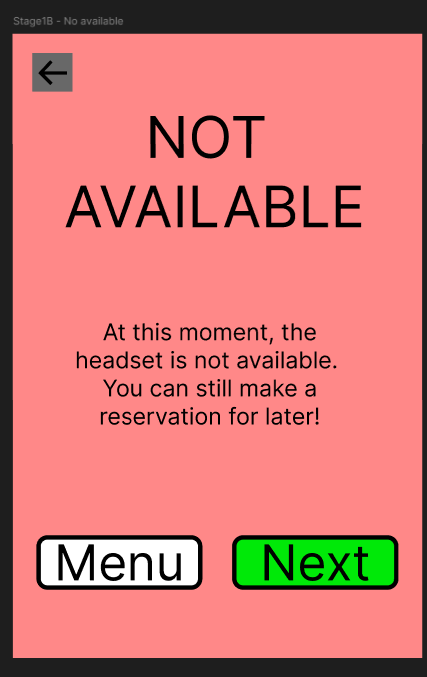 | 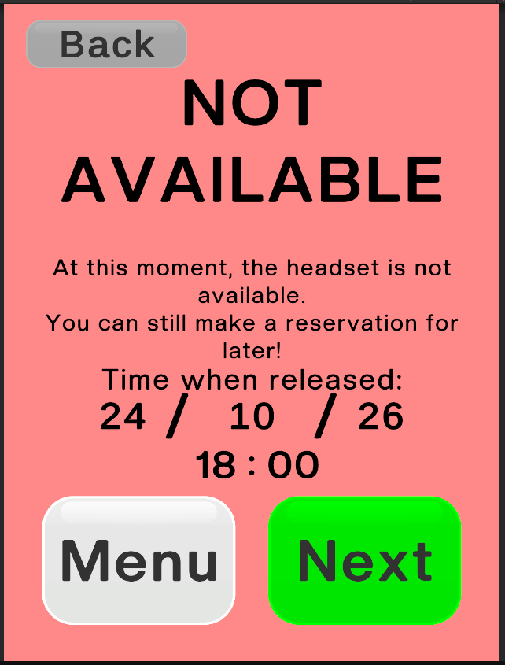 |

### Decision 2: In the duration panel the user only adjusts the duration, not the start of the reservation

| | |
|---|---|
| **User problem** | In the Figma design the user could adjust both the start and the duration of the reservation. This made reserving a kit more complicated than it needed to be. |
| **HCI principle** | FILL IN |
| **How the design addresses it** | The duration panel only asks for the duration. The start is not chosen by the user: it is the current time if the kit is free, or the time when the kit is released if it is occupied (see Decision 1). The user makes fewer choices to reserve a kit, and the implementation is simpler. The same change was made in Order Check, which no longer shows the pick-up date and time. |
| **Evidence** | FILL IN (test case or participant ID, see [testing.md](testing.md)) |

| Figma | Unity |
|---|---|
| 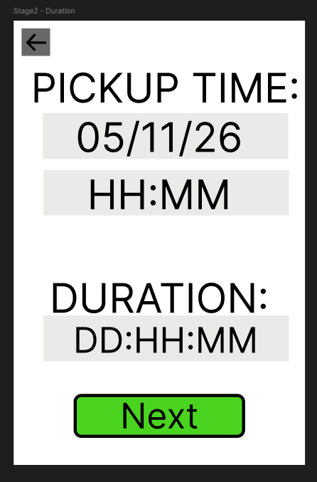 | 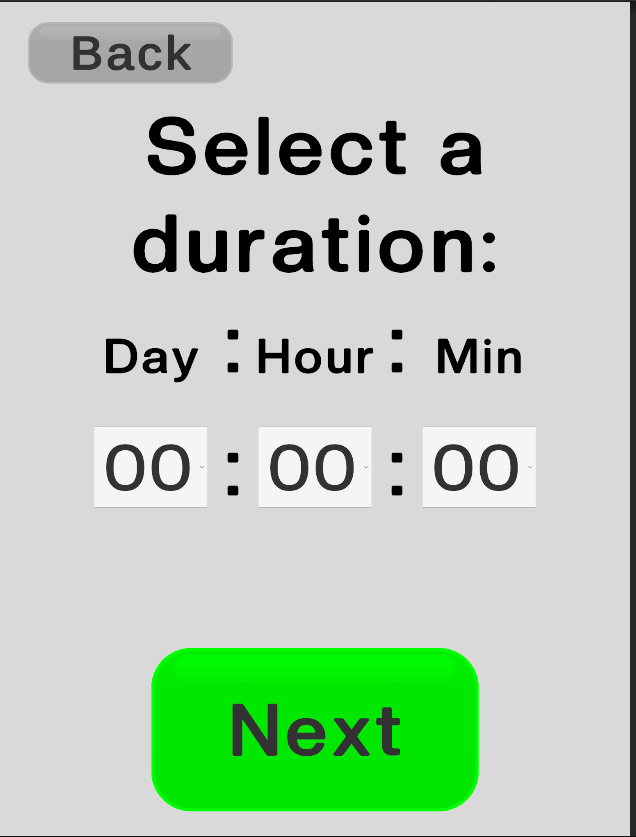 |

### Decision 3: Large, interactive-looking, consistent buttons, and few buttons per panel

| | |
|---|---|
| **User problem** | FILL IN |
| **HCI principle** | Affordance and consistency: the buttons are easy to see, select and handle. |
| **How the design addresses it** | The buttons are large and look interactive, there are only a few in each panel, and they are consistent with each other. For example, all the Next and Back buttons are in the same positions in every panel: Back is in the top-left corner and Next is a green button at the bottom. |
| **Evidence** | FILL IN (test case or participant ID, see [testing.md](testing.md)) |

| Unity: duration | Unity: order check | Unity: not available |
|---|---|---|
|  | 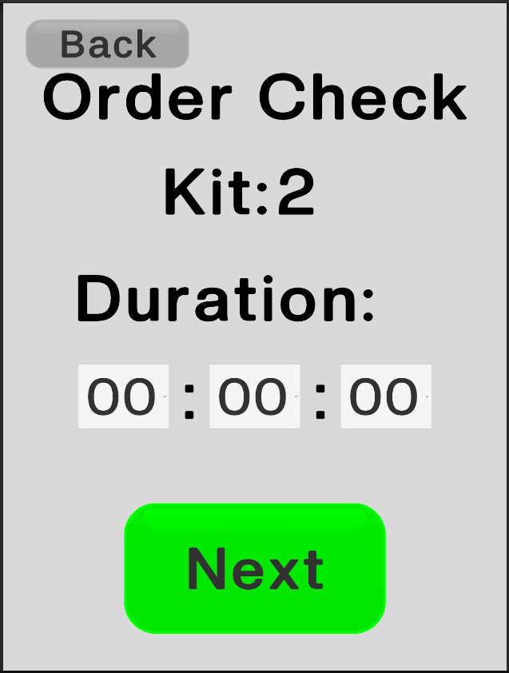 |  |

---

## 2. Figma vs Unity

### Implementation context

These parts of the implementation shaped some of the changes:

- **Data:** the kits are stored in three JSON files: one for scenario A, one for scenario B, and one that is updated constantly with the changes.
- **Managers in the scene:**
  - A panel manager (`CanvasManager`) that changes the Unity panels.
  - `KitManager`, which saves the data and finishes modifying it.
  - A combo manager, which reads the interaction and resets the data according to the command.
  - `KitSelector`, which stores the data while the user moves through the panels so it is saved at the end.

### Overview of all screens

- Figma: [figmaComplete](images/figmaComplete.pdf)
- Unity: [unityComplete](images/unityComplete.pdf)

### Screen comparison

| Screen | Figma | Unity |
|---|---|---|
| Kit selection (scenario A) | 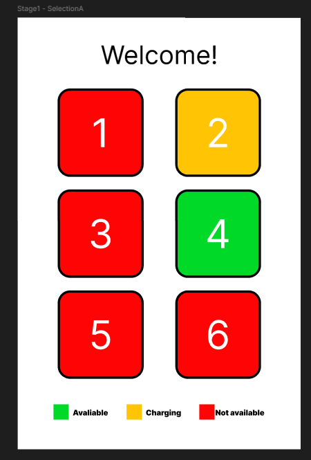 | 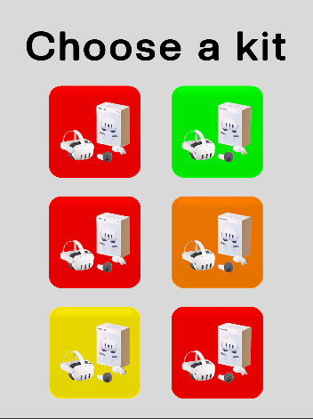 |
| Kit selection (scenario B) | 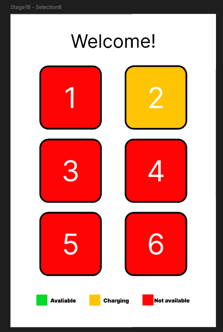 | 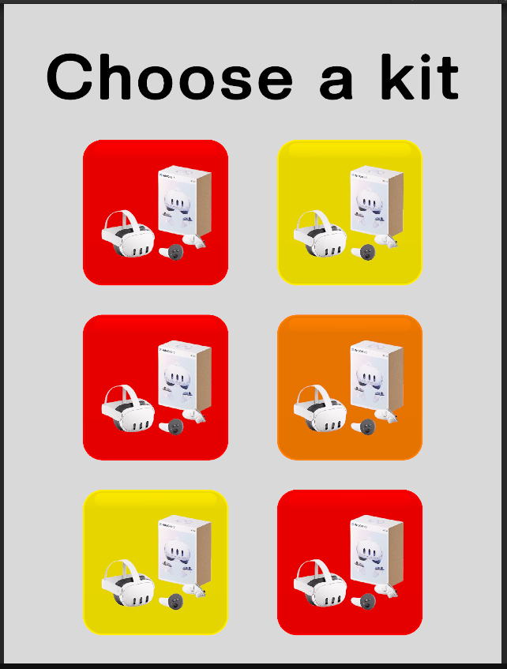 |
| Duration |  |  |
| Kit check | 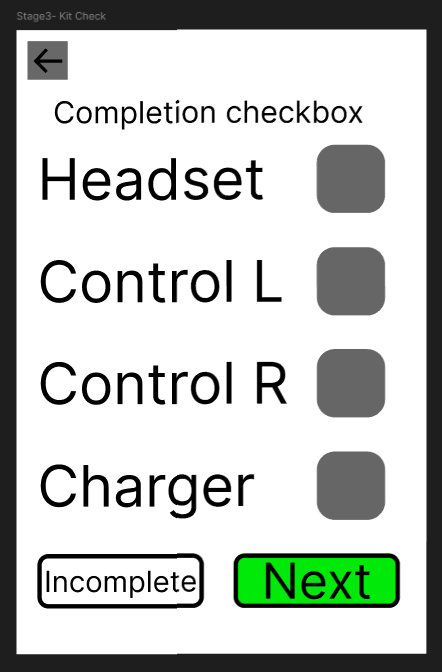 | 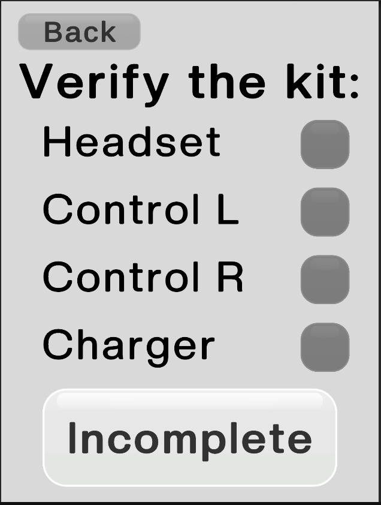 |
| Order check | 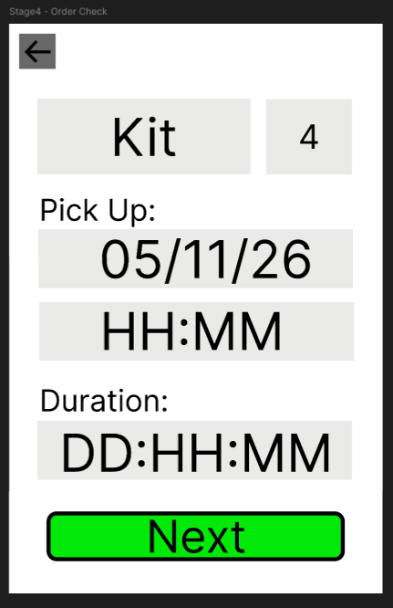 |  |
| Confirmation | 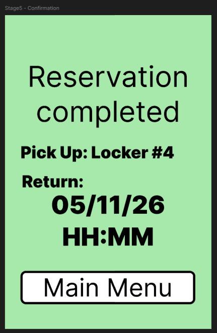 | 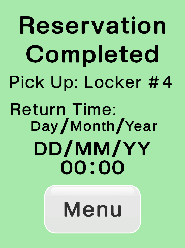 |
| Not available |  |  |
| Charging | 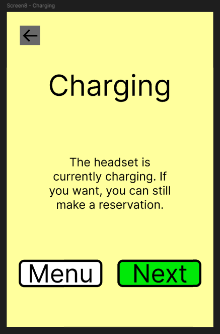 | 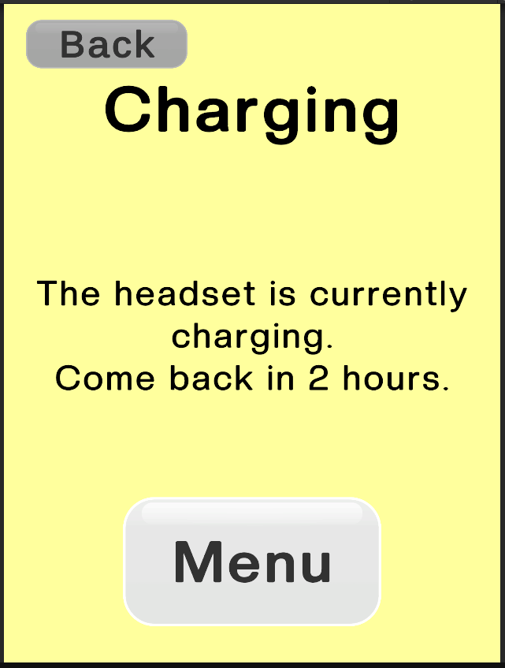 |
| Incomplete | 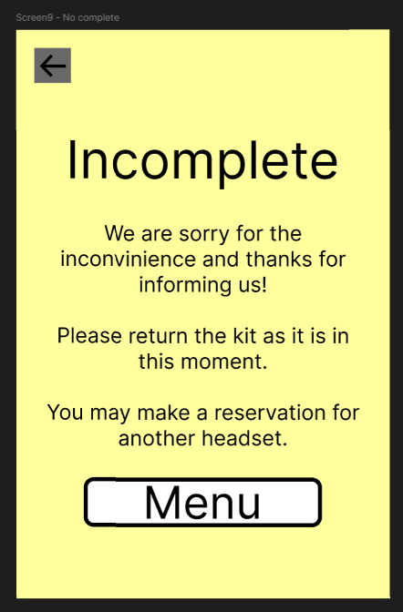 | 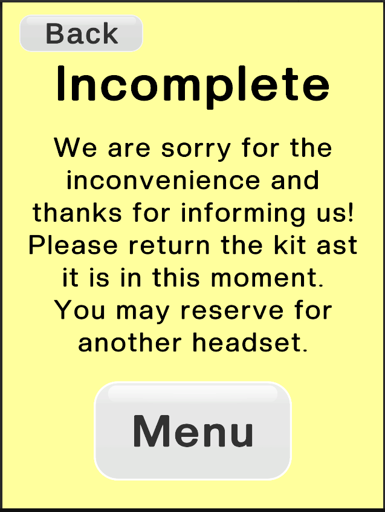 |

### What changed and why

| # | Screen | What Changed | Reason |
|---|---|---|---|
| 1 | Kit selection |  |  |
| 2 | Duration |  |  |
| 3 | Kit check |  |  |
| 4 | Order check |  |  |
| 4 | Charging |  |  |

**Type** is *Implementation* (needed by Unity, data or time) or *Testing* (changed after a test; cite the case or participant, e.g. TC-04, P2).

**Candidate differences to check against your Figma file** (keep only the ones that are true):

- **Duration input:** dropdowns (days 0-7, hours 0/1/2/3/6/12, minutes 0-30) instead of a free time picker, because they keep the value valid and are easy to read from `TMP_Dropdown` in code.
- **Confirmation screen:** day, month, year, hour and minute are separate text fields, so each one is filled independently by `KitSelector`.
- **Kit state on buttons:** four states come from `Kits.json` and are applied in `KitManager.RefreshAll()`, so the button appearance depends on saved data and not only on the design.
- **Expired rentals:** kits whose time has passed change state automatically (`CheckExpired()`), which the static Figma frames cannot show.
- **Changes after testing:** `<e.g. review duration became editable after P2 wanted to change it>`.